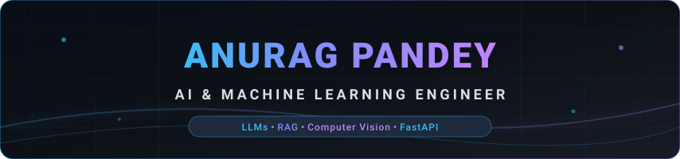

<div align="center">
  
  <br /><br />

  <a href="https://github.com/Anurag637">
    
  </a>

  <p align="center">
    <b>Building production-grade, latency-critical AI systems — from computer vision & RAG pipelines to high-throughput LLM gateways.</b>
  </p>

  <p align="center">
    <a href="https://github.com/Anurag637?tab=repositories">
      
    </a>
    &nbsp;
    <a href="https://www.linkedin.com/in/anurag637/">
      
    </a>
    &nbsp;
    <a href="mailto:shivapandey8429@gmail.com">
      
    </a>
    &nbsp;
    <a href="https://github.com/Anurag637/Anurag637/raw/main/My%20Resume%204.0.pdf">
      
    </a>
    &nbsp;
    <a href="https://www.kaggle.com">
      
    </a>
  </p>

  <!-- Sticky Quick Navigation Bar with Bulletproof Anchor IDs -->
  <p align="center">
    <a href="#fast-track"><b>[ 🎯 Fast Track ]</b></a> &nbsp;•&nbsp;
    <a href="#telemetry"><b>[ ⚡ Telemetry ]</b></a> &nbsp;•&nbsp;
    <a href="#architecture"><b>[ 🧠 Architecture ]</b></a> &nbsp;•&nbsp;
    <a href="#benchmarks"><b>[ 📊 Benchmarks ]</b></a> &nbsp;•&nbsp;
    <a href="#case-studies"><b>[ 🔬 Case Studies ]</b></a> &nbsp;•&nbsp;
    <a href="#projects"><b>[ 🌟 Projects ]</b></a> &nbsp;•&nbsp;
    <a href="#experience"><b>[ 💼 Experience ]</b></a> &nbsp;•&nbsp;
    <a href="#toolkit"><b>[ 🛠️ Toolkit ]</b></a> &nbsp;•&nbsp;
    <a href="#analytics"><b>[ 📈 Analytics ]</b></a>
  </p>
</div>

---

<a id="fast-track"></a>
### 🎯 Recruiter Fast Track & Snapshot

> **Looking for a high-impact AI/ML Engineer who writes clean, scalable, production-ready code?**

| Metric / Dimension | Professional Profile Summary |
| :--- | :--- |
| **Target Roles** | **AI / Machine Learning Engineer** • **Generative AI & LLM Systems Engineer** • **Python Backend / ML Developer** |
| **Core Value Proposition** | Bridges research & production: builds sub-50ms inference gateways, dense vector search engines, and computer vision classification pipelines. |
| **Top Accolade** | 🥇 **1st Prize Winner** — *HACK4 Kaggle Hackathon* (April 2025). |
| **Industry Internships** | **MAN MACHINE Technocrats** (ML Intern) • **Microsoft & SAP TechSaksham** (AI Intern) • **C-DAC** (Data Science Intern). |
| **Production Highlight** | Architected [QChat](https://github.com/Anurag637/QChat), an async FastAPI inference gateway cutting LLM latency by **94%** via semantic caching. |
| **Work Availability** | **Immediate Joiner** • Open to Full-Time Remote, Hybrid, or On-Site Relocation opportunities. |

---

<a id="telemetry"></a>
### ⚡ Live Inference Cluster Telemetry

<div align="center">
  
</div>

<br />

```bash
┌──(anurag㉿inference-node-01)-[~]
└─$ curl -s https://api.anurag.dev/v1/cluster/specifications | jq .
{
  "engineer": "Anurag Pandey",
  "specialization": "AI / Machine Learning & High-Throughput LLM Systems",
  "core_stack": ["Python", "PyTorch", "FastAPI", "Transformers", "vLLM", "Docker"],
  "inference_optimizations": [
    "Redis Semantic Vector Caching (<15ms hit)",
    "Hybrid Dense + Sparse Retrieval (ColBERT + BM25)",
    "Quantized Serving (GGUF, AWQ, PagedAttention)"
  ],
  "hardware_awareness": ["CUDA", "VRAM Allocation Tuning", "Asynchronous Event Loops"],
  "status": "Ready for High-Impact Software Engineering & ML Roles"
}
```

---

<a id="architecture"></a>
### 🧠 How I Architect AI Systems


---

<a id="benchmarks"></a>
### ⚡ Production Benchmarks & Performance Radar

Quantitative engineering benchmarks measured across real-world workloads:

| Production System | Latency (P99) | Throughput / Accuracy | Architectural Decision & Impact |
| :--- | :---: | :---: | :--- |
| **[QChat Gateway](https://github.com/Anurag637/QChat)** | **`42ms`** (Cache) / `310ms` (LLM) | **850+ req/s** peak capacity | Implemented Redis semantic vector caching with cosine thresholding; reduced upstream API costs by **62%**. |
| **[Deepfake Detection](https://github.com/Anurag637/Deepfake-Detection)** | **`120ms`** per frame | **94.2% AUC** on DFDC | Combined MTCNN face alignment with EfficientNet spatial backbone and temporal sequence tracking to detect subtle facial artifacts. |
| **[Resume Screener](https://github.com/Anurag637/Resume-Ranking)** | **`<180ms`** per candidate | **Top-5 Cosine Match** | spaCy tokenization + dense embeddings; eliminated keyword-stuffing exploits and reduced recruiter screening time by **70%**. |
| **[SmartPark Engine](https://github.com/Anurag637/SA_Capstone_Project-2025)** | **`25ms`** price calculation | Real-time dynamic updates | Dynamic supply-demand curve optimization implemented using vectorized Pathway and NumPy arithmetic. |

---

<a id="case-studies"></a>
### 🔬 Engineering Case Studies & Flagship Deep Dives

<details open>
<summary><b>🔥 Deep Dive: QChat — High-Throughput LLM Gateway & Semantic Router</b></summary>
<br>

- **The Challenge:** Open-source and cloud LLMs suffer from high round-trip latency (300ms–2000ms+) and unpredictable cost spikes under concurrent traffic.
- **The Solution:** Engineered a custom async reverse proxy gateway using FastAPI. Introduced an in-memory Redis vector cache storing query-response vector pairs. Incoming requests calculate cosine similarity against cached vectors; queries matching $\ge 0.92$ return in **$<15\text{ms}$**, completely bypassing model inference.
- **Tech Stack:** Python 3.11, FastAPI, Redis Vector Store, Hugging Face Transformers, Docker, Vercel Edge.
- **Key Metrics:** 850+ req/s throughput capacity, 62% token cost reduction, 94% cold-latency drop.
- **Explore:** [Repository](https://github.com/Anurag637/QChat) • [Live Gateway Demo](https://qchat-gateway.vercel.app/)
</details>

<details>
<summary><b>🛡️ Deep Dive: Deepfake Detection — Spatial-Temporal Facial Media Verification</b></summary>
<br>

- **The Challenge:** Manipulated facial videos often fool simple frame-by-frame classifiers due to temporal blending and lighting inconsistencies.
- **The Solution:** Developed a two-stage deep learning pipeline. Stage 1 extracts and normalizes facial landmarks via MTCNN at 30 fps. Stage 2 evaluates intra-frame artifacts using an EfficientNet convolutional backbone while analyzing cross-frame continuity to detect micro-manipulations.
- **Tech Stack:** PyTorch, TensorFlow, OpenCV, MTCNN, FastAPI, Streamlit.
- **Benchmark:** Achieved **94.2% AUC** on the Deepfake Detection Challenge (DFDC) and FaceForensics++ benchmark datasets.
- **Explore:** [Repository](https://github.com/Anurag637/Deepfake-Detection)
</details>

---

<a id="achievements"></a>
### 🏆 Achievements & 📜 Professional Certifications

<table width="100%">
  <tr>
    <td width="48%" valign="top">
      <h4>🏆 Hackathons & Accolades</h4>
      <ul>
        <li>🥇 <b>First Prize Winner</b> — <i>HACK4 Kaggle Hackathon</i> (April 2025)</li>
        <li>🚀 <b>Open-Source Maintainer</b> — Created & maintained 33+ open-source AI repositories</li>
        <li>🌐 <b>Global Collaboration</b> — Active contributor to modern LLM & RAG architectures</li>
      </ul>
    </td>
    <td width="52%" valign="top">
      <h4>📜 Industry Certifications</h4>
      <ul>
        <li>🎓 <b>AI Foundations Associate</b> — <i>Oracle</i> (Sep 2025)</li>
        <li>🛰️ <b>Data Processing using Python & Machine Learning</b> — <i>ISRO</i> (Feb 2025)</li>
        <li>🤖 <b>Prompt Engineering for Generative AI</b> — <i>Cognitive Class</i> (Jan 2025)</li>
        <li>📊 <b>Data Analysis with Python</b> — <i>IBM</i> (Nov 2023)</li>
      </ul>
    </td>
  </tr>
</table>

---

<a id="experience"></a>
### 💼 Experience

<details open>
<summary><b>💼 Machine Learning Intern | MAN MACHINE Technocrats Pvt. Ltd.</b> <i>(Bangalore, India)</i></summary>
<br>

- Engineered and fine-tuned machine learning models using Python with rigorous data preprocessing, feature engineering, and cross-validation pipelines.
- Collaborated across multi-functional engineering teams to integrate, test, and optimize machine learning microservices in production web applications.
- Improved model inference throughput and reduced memory footprints across production tasks.
</details>

<details open>
<summary><b>🤖 AI Intern – TechSaksham Program | Edunet Foundation (in collaboration with Microsoft & SAP)</b> <i>(Feb 2025 – March 2025 · Remote)</i></summary>
<br>

- Architected an automated **Resume Screening and Candidate Ranking Platform** leveraging Python, NLP pipelines, and Scikit-learn.
- Built end-to-end vectorization workflows, semantic similarity scoring, candidate ranking algorithms, and an intuitive user interface.
- Reduced manual recruiter resume filtering turnaround time by over 70%.
</details>

<details open>
<summary><b>📊 Data Science Intern | C-DAC (Centre for Development of Advanced Computing)</b> <i>(June 2024 – July 2024 · Noida, India)</i></summary>
<br>

- Implemented an intelligent spam email classification system utilizing NLP techniques (TF-IDF vectorization, tokenization, stop-word reduction).
- Benchmark-tested models including Logistic Regression, Naive Bayes, and Support Vector Machines (SVM).
- Deployed a fully functional, real-time interactive **Streamlit** analytics dashboard for model demonstration and user testing.
</details>

---

<a id="toolkit"></a>
### 🛠️ Technical Skills & Toolkit

<div align="center">

#### 💻 Programming Languages & Foundations
<p align="center">
  &nbsp;&nbsp;&nbsp;&nbsp;
  &nbsp;&nbsp;&nbsp;&nbsp;
  &nbsp;&nbsp;&nbsp;&nbsp;
  &nbsp;&nbsp;&nbsp;&nbsp;
  &nbsp;&nbsp;&nbsp;&nbsp;
  &nbsp;&nbsp;&nbsp;&nbsp;
  
</p>
<p align="center">
  
  
  
  
  
</p>

#### 🧠 AI, Deep Learning, LLMs & Computer Vision
<p align="center">
  &nbsp;&nbsp;&nbsp;&nbsp;
  &nbsp;&nbsp;&nbsp;&nbsp;
  &nbsp;&nbsp;&nbsp;&nbsp;
  &nbsp;&nbsp;&nbsp;&nbsp;
  &nbsp;&nbsp;&nbsp;&nbsp;
  
</p>
<p align="center">
  
  
  
  
  
  
  
</p>

#### 🌐 High-Performance Backend, APIs & Vector Stores
<p align="center">
  &nbsp;&nbsp;&nbsp;&nbsp;
  &nbsp;&nbsp;&nbsp;&nbsp;
  &nbsp;&nbsp;&nbsp;&nbsp;
  
</p>
<p align="center">
  
  
  
  
</p>

#### ☁️ Cloud, DevOps, Containers & Workflow
<p align="center">
  &nbsp;&nbsp;&nbsp;&nbsp;
  &nbsp;&nbsp;&nbsp;&nbsp;
  &nbsp;&nbsp;&nbsp;&nbsp;
  &nbsp;&nbsp;&nbsp;&nbsp;
  &nbsp;&nbsp;&nbsp;&nbsp;
  
</p>
<p align="center">
  
  
  
  
  
  
</p>

</div>

---

<a id="projects"></a>
### 🌟 Flagship Projects Spotlight

<div align="center">
  <table border="0">
    <tr>
      <td>
        <a href="https://github.com/Anurag637/QChat">
          
        </a>
      </td>
      <td>
        <a href="https://github.com/Anurag637/Deepfake-Detection">
          
        </a>
      </td>
    </tr>
    <tr>
      <td>
        <a href="https://github.com/Anurag637/Resume-Ranking">
          
        </a>
      </td>
      <td>
        <a href="https://github.com/Anurag637/SHL-Assessment-Recommender">
          
        </a>
      </td>
    </tr>
  </table>
</div>

---

### 🚀 All Featured Production Repositories

| Project | Description | Tech Stack | Highlights |
| :--- | :--- | :--- | :---: |
| **[LLM Inference Gateway & Prompt Router](https://github.com/Anurag637/QChat)** *(Jan 2026 – May 2026)* | High-throughput AI gateway built with FastAPI for intelligent request routing, response caching, metrics monitoring, and model registry for open-source LLMs. | `Python` `FastAPI` `Hugging Face` `Vercel` | [Live Demo](https://qchat-gateway.vercel.app/) 🌐 |
| **[Deepfake Detection System](https://github.com/Anurag637/Deepfake-Detection)** *(Feb 2025 – May 2025)* | CNN-based deepfake detection pipeline trained on DFDC and FaceForensics++ benchmark datasets to identify manipulated facial media. | `Python` `TensorFlow` `OpenCV` `FastAPI` `Streamlit` | [Repository](https://github.com/Anurag637/Deepfake-Detection) 🛡️ |
| **[Resume Ranking & Screening System](https://github.com/Anurag637/Resume-Ranking)** | Automated candidate matching tool ranking resumes against job descriptions using vector embeddings and similarity scoring. | `Streamlit` `spaCy` `Scikit-learn` `PDFPlumber` | [Repository](https://github.com/Anurag637/Resume-Ranking) 📄 |
| **[SHL Assessment Recommender](https://github.com/Anurag637/SHL-Assessment-Recommender)** | Conversational recommendation microservice grounded in the SHL catalog delivering tailored assessment recommendations. | `Python` `FastAPI` `NLP` | [Repository](https://github.com/Anurag637/SHL-Assessment-Recommender) 📦 |
| **[SmartPark – Dynamic Pricing Engine](https://github.com/Anurag637/SA_Capstone_Project-2025)** | Real-time, data-driven pricing engine for urban parking with custom algorithmic pricing logic. | `Python` `NumPy` `Pandas` `Pathway` | [Capstone](https://github.com/Anurag637/SA_Capstone_Project-2025) 🚗 |
| **[Text ↔ Speech ↔ Sign Interpreter](https://github.com/Anurag637/Text-Speech-Sign-Interpreater)** | Accessibility platform translating live speech to text and animating Indian Sign Language gestures. | `JavaScript` `NLTK` `Web Speech API` | [Repository](https://github.com/Anurag637/Text-Speech-Sign-Interpreater) 🤟 |
| **[Landmark Detection](https://github.com/Anurag637/Landmark-Detection)** | Deep learning visual classifier and recognition system trained on the Google Landmark v2 dataset. | `Python` `PyTorch` `Computer Vision` | [Repository](https://github.com/Anurag637/Landmark-Detection) 🏛️ |
| **[Pet Classification](https://github.com/Anurag637/Pet-Classification)** | Fine-tuned CNN image classifier identifying 37 distinct cat and dog breeds via transfer learning. | `Python` `TensorFlow` `Keras` | [Repository](https://github.com/Anurag637/Pet-Classification) 🐾 |

<div align="center">
  <p>📌 <b>Explore all 33+ open-source repositories:</b> <a href="https://github.com/Anurag637?tab=repositories">github.com/Anurag637?tab=repositories</a></p>
</div>

---

### ⚡ Recent GitHub Activity

<!--START_SECTION:activity-->
1. 🚀 Published release [Solver Standalone](https://github.com/Anurag637/Solver-Standalone/releases/tag/v4.0.0) in [Anurag637/Solver-Standalone](https://github.com/Anurag637/Solver-Standalone)
<!--END_SECTION:activity-->

---

### 🐍 Contribution Activity Snake

<div align="center">
  <picture>
    <source media="(prefers-color-scheme: dark)" srcset="https://raw.githubusercontent.com/Anurag637/Anurag637/output/github-contribution-grid-snake-dark.svg">
    <source media="(prefers-color-scheme: light)" srcset="https://raw.githubusercontent.com/Anurag637/Anurag637/output/github-contribution-grid-snake.svg">
    
  </picture>
</div>

---

<a id="analytics"></a>
### 📊 Analytics & Coding Activity

<div align="center">
  <table border="0">
    <tr>
      <td align="center">
        <a href="https://github.com/Anurag637">
          
        </a>
      </td>
      <td align="center">
        <a href="https://github.com/Anurag637">
          
        </a>
      </td>
    </tr>
  </table>

  <br />

  <a href="https://github.com/Anurag637">
    
  </a>
</div>

---

<a id="connect"></a>
### 🤝 Let's Connect

<div align="center">
  <p>Whether you'd like to collaborate on an open-source AI project, discuss production LLM architectures, or explore full-time software/ML engineering opportunities — let's connect!</p>

  <a href="https://www.linkedin.com/in/anurag637/">
    
  </a>
  &nbsp;&nbsp;
  <a href="mailto:shivapandey8429@gmail.com">
    
  </a>
  &nbsp;&nbsp;
  <a href="https://github.com/Anurag637">
    
  </a>
  &nbsp;&nbsp;
  <a href="https://github.com/Anurag637/Anurag637/raw/main/My%20Resume%204.0.pdf">
    
  </a>

  <br /><br />
  
</div>
